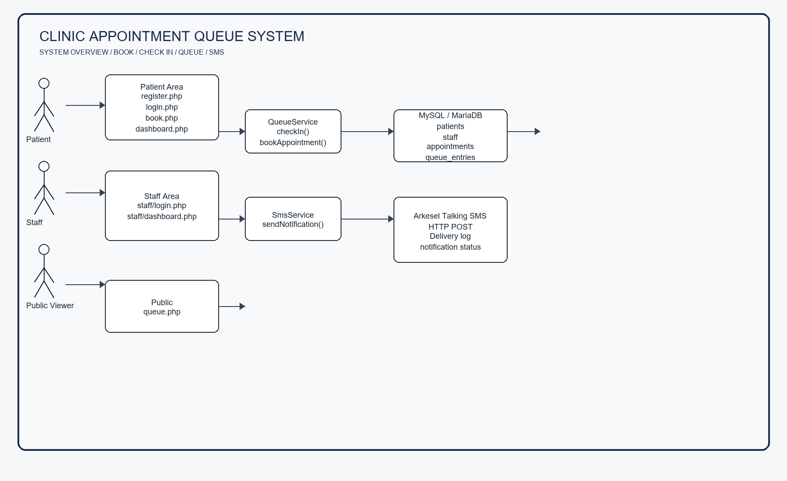
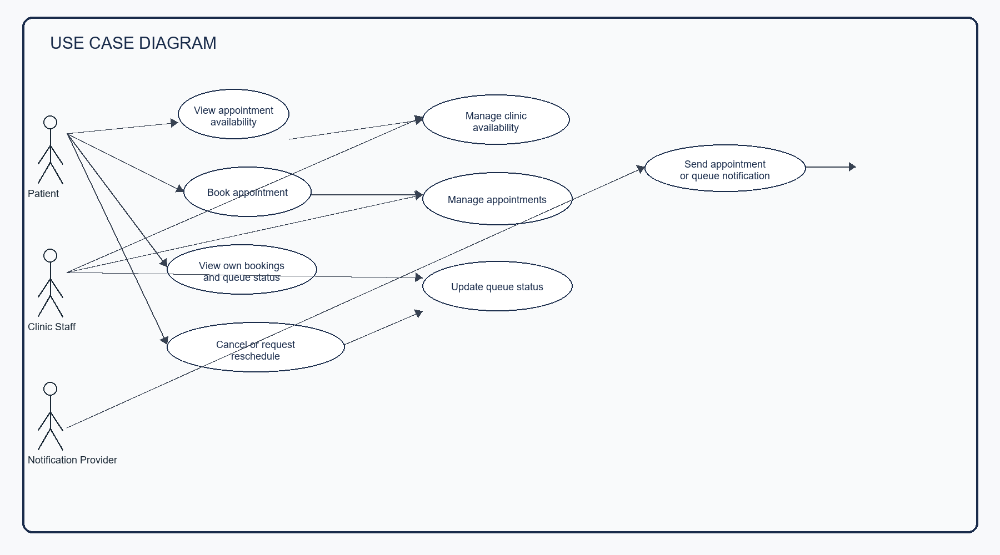
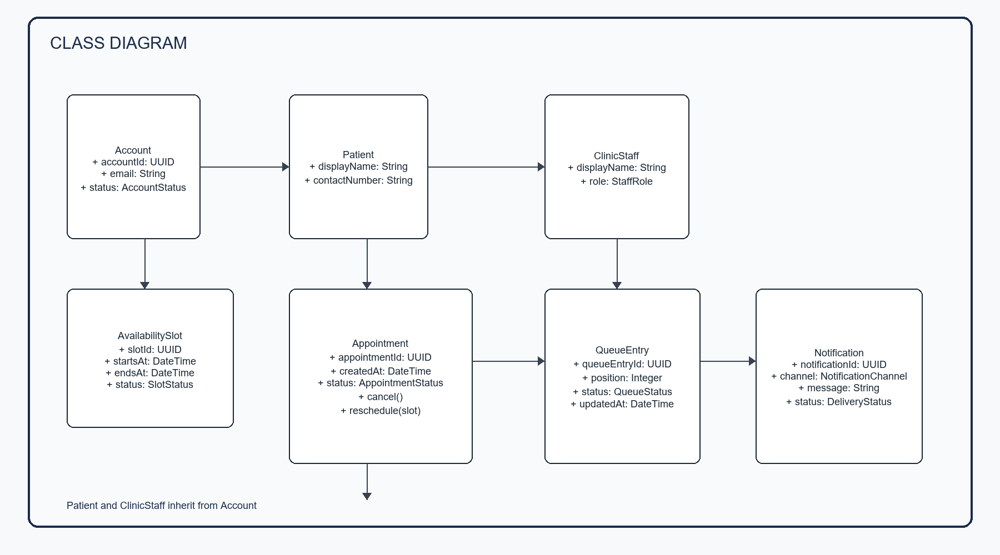
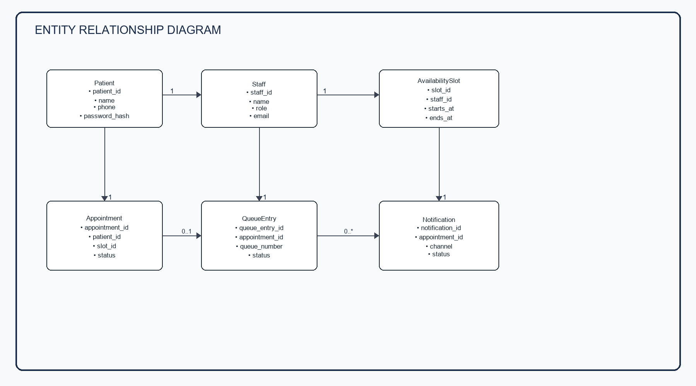
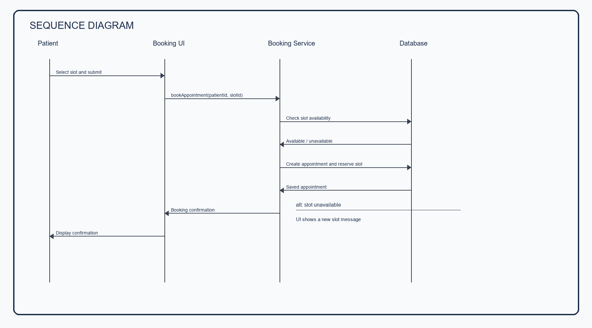
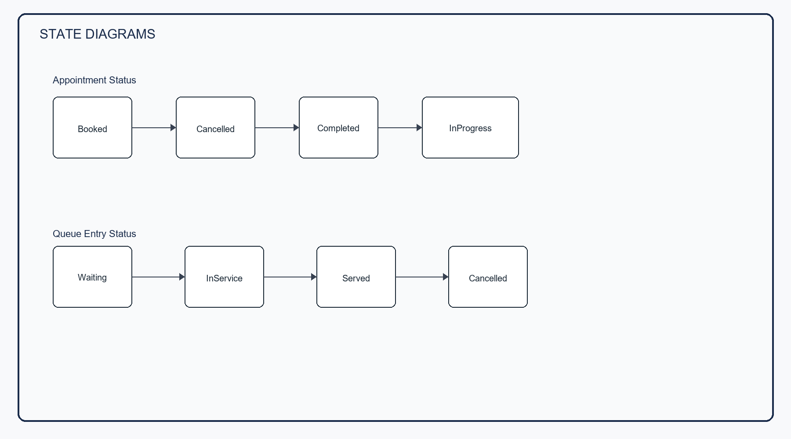

# UML Diagrams

## 1. Architecture overview

[System overview source](./system-overview.puml)

## 2. Use case diagram

[Use-case source](./use-case-diagram.puml)

## 3. Class diagram

[Class diagram source](./class-diagram.puml)

## 4. Entity relationship diagram

[ER diagram source](./entity-relationship-diagram.puml)

## 5. Sequence diagram

[Appointment-booking sequence source](./appointment-booking-sequence.puml)

## 6. State diagrams

[State diagram source](./state-diagrams.puml)
